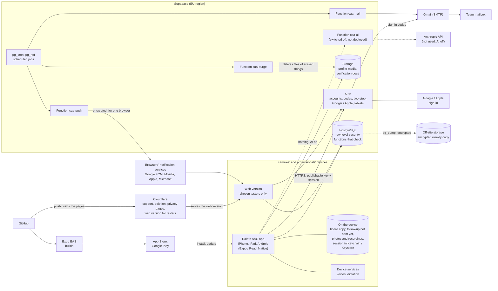

# Architecture

How the app is built, where each kind of data lives, how to start working on it, and how to hand
it to another team. Assessment items: 14.10, 14.13. For the "why" of each feature, read
`docs/HOW-IT-WORKS.md`; for the rules of the project, `CLAUDE.md` (read it first).

## 1. The picture



Two facts shape everything else:

- **The board works without the server.** Each device keeps the child's profile and plays it
  offline; the server is for accounts, sharing between devices and people, and the back office.
- **The database decides, never the app.** Every table has row-level security; delicate actions
  go through SQL functions that check the caller first. A modified app cannot read another
  family's data (`docs/SECURITY.md`).

The owner's plan (November 2026): the product is sold in the App Store and Google Play only.
Today the web version of the app is for chosen testers: Cloudflare publishes it from the default
branch, next to the support, account-deletion and privacy pages (`public/`). Its sign-up stays
open (the owner's choice: there is no list of testers), but it is not offered or sold to families.
The same web build serves the demo and the accessibility scan. Browser notifications
(`caa-push`) exist for the web version only. Billing (families monthly or yearly, professionals
once) is to come.

## 2. Where each kind of data lives

### On the server (Supabase)

From `supabase/README.md`, "What is where", plus what was added in November 2026.

| Data | Where |
|---|---|
| Accounts: role, name, preferences (menus' language, a professional's own caregiver code) | `accounts`, and Supabase Auth (`auth.users`: e-mail or phone, scrambled password, two-step factors) |
| A child's AAC profile (one JSON document + a version number) | `profiles` |
| A deleted child's profile, for 30 days | The bin (`profiles.deleted_at`; erased by the nightly job after 30 days). Words and activity boards deleted on a board wait 30 days in the profile's own bin, inside the profile (`src/lib/wordBin.ts`) |
| Earlier copies of a board (weekly and before big changes, last 10) | Board snapshots |
| Who works on which profile, with role, level and rights | `members` |
| Invitations and connection requests | `invitations` |
| Suggested changes waiting for the parent | `proposals` |
| Configuration changes, with undo (never what the child said) | `history` |
| Linked tablets and phones; codes to link them (10 minutes) | `devices`, `pairing_codes` |
| Professionals' verification requests | `verifications`; their files in the private bucket `verification-docs` |
| Photos and recordings of a child, shared between the child's devices | Private bucket `profile-media` (one folder per child); a file no board uses any more stays 30 days, then a manager's device removes it (`media_in_use` decides) |
| Communication follow-up, per child, device and day (only what the family allowed) | `usage_days` |
| Adults' notes on communication moments | `observations` |
| The parent's consent at profile creation (date, text version) | Consent records |
| In-app notifications | `notices` |
| Professionals' materials and what they share | `resources`, `resource_shares` |
| The team's own list, and what it did | `admins`, `admin_log` |
| Messages to the team, ideas and votes | `feedback`, `roadmap`, `roadmap_votes` |
| Feature counters, technical problems (families who agreed only) | `feature_days`, `error_counts` |
| Anonymous figures for the team | `research_usage`, `bo_people`, `bo_child_days` (views) |
| AI calls per account and day; daily ceiling | `ai_calls`, `ai_budget` |
| Recent actions, to refuse repeats | `rate_log` (2 days) |
| E-mails written for the team, and where the sending function is (its key also opens `caa-purge` and `caa-push`) | `team_mail`, `team_mail_config` |
| Files waiting to be deleted after an account, a child's profile or a professional's document is erased | `storage_purge` (emptied by `caa-purge`; a line goes 100 days after its files are deleted: longer than the oldest off-site copy) |
| The names of the files a save stopped using (random names only), so that they stay 30 days | `media_dropped` |
| Browsers that accepted notifications (web version), notifications waiting, the signing keys (private half sealed), when a child's board was last opened | `push_subs`, `push_out`, `push_config`, `profile_seen` |

None of these tables can be read by someone who is not signed in. The retention of each is in
`docs/legal/RETENTION-SCHEDULE.md`.

### On the device

`src/lib/deviceData.ts` decides how these leave the device (sign out, delete, session ended
elsewhere). Never remove one of these by hand.

| Data | Key or place |
|---|---|
| The copy of each child's profile (works offline) | `caa.child.<profile id>` (AsyncStorage); a copy that could not be read is put aside under `caa.child.<profile id>.bad` |
| Follow-up days not sent yet (kept 120 days) | `caa.usage.<profile id>` |
| Feature counters not sent yet | `caa.product.<profile id>` |
| Answers being typed during the set-up | `caa.onboarding.*` |
| The role chosen before signing in; the caregiver keypad's pauses | `caa.pendingRole`, `caa.pinlock` |
| The session | iOS Keychain / Android Keystore on the apps; the visit's store when "Keep me logged in" is off (`src/lib/keepSignedIn.ts`, `src/lib/visit.ts`) |
| Photos and recordings | Files of the app (`src/lib/media.ts`); names follow one pattern (`mediaNamesIn`) |
| Files made to print or share | Temporary files; `clearExports` removes them on sign out |

### Not stored by us

| Data | Where it goes |
|---|---|
| Speech of the voice (text to speech) | The device's own voices |
| Dictation | The device's speech recognition (Apple, Google); on the device where the system offers it, otherwise their servers |
| Notifications outside the app (web version, if the person turned them on) | The browser's own notification service (Google FCM, Mozilla, Apple or Microsoft), encrypted for that browser: it carries the message without being able to read it. `caa-push` posts to these services only (`isPushService`, and `push_endpoint_ok` in the database) |
| AI requests | Nothing today: the AI helper is switched off and `caa-ai` is not deployed (owner's decision, November 2026). The code stays |

## 3. Code map

| Folder | What is in it |
|---|---|
| `App.tsx`, `index.ts` | Start of the app |
| `src/ui/` | Screens. `Root.tsx` (one surface with the universal bar), `Stages.tsx` (which screen for which step), `UniversalBar.tsx`, `Grid.tsx`, `common.tsx` (`Panel`, buttons), `a11y.ts` (states for screen readers), `theme.ts` (colours, tested for contrast) |
| `src/ui/start/` | Welcome, who are you, log in / sign up, link a tablet with a code |
| `src/ui/onboarding/` | The set-up journey of a child's profile |
| `src/ui/screens/` | The board, activity boards, schedule |
| `src/ui/panels/` | Panels over the board: settings of the board (`CaregiverPanels.tsx`), search, guide, new word… |
| `src/ui/settings/` | Settings pages: Team, Account (privacy, deletion, devices) |
| `src/ui/data/` | The Progress page (follow-up charts) |
| `src/ui/pro/` | The professional workspace |
| `src/ui/admin/` | The back office and "Help us improve Daleth AAC" |
| `src/state/` | Shared state: `Session.tsx` (who is signed in, which step), `AppState.tsx` (the board, overlays), `profileSync.ts` (device copy ↔ server, every 30 s with `profileVersion`; a refused save never stops receiving; what stays on each device: `src/lib/deviceOnly.ts`), `usageTracker.ts` (follow-up), `productCounters.ts` (counters for the team), `ownCode.ts` (a professional's own code) |
| `src/lib/` | Logic without screens: grammar, search, voices, permissions, `profileDiff.ts` (changes, proposals, undo), `safety.ts` (cleaning what comes from others), `deviceData.ts`, `product.ts`, `notices.ts`, `childLock(.web).ts`… |
| `src/backend/` | One contract (`Backend.ts`), two servers: `supabase.ts` (real) and `local.ts` (demo on the device); `index.ts` picks one |
| `src/data/` | Words (`concepts.ts`), the core board (`defaults.ts`: **never move core cells**), dialects, the guide (`guide.ts`), set-up help, situations, pictogram index |
| `src/i18n/` | Words of the menus in French, English and Arabic |
| `src/model/types.ts` | Shapes of a profile, a board, the settings |
| `src/__tests__/` | Jest tests; `live/` runs against a real test project |
| `supabase/migrations/` | The database, one dated SQL file per change (never edit one that already ran) |
| `supabase/functions/` | Server functions: `caa-mail` (team e-mails), `caa-purge` (deletes the stored files of what was erased), `caa-push` (browser notifications); `caa-ai` (AI helper: kept in the code, not deployed). The three called by the database have "Verify JWT" off (`supabase/config.toml`) and check a key of the database instead |
| `supabase/tests/` | Database scenarios played by `npm run test:db`, including every known attack |
| `supabase/email-templates/` | Sign-in code e-mails (pasted in the Supabase dashboard) |
| `scripts/` | Tests of the database and accessibility, pictogram builds, the off-site backup |
| `pictograms/`, `assets/` | Pictogram libraries (licences, translations, database) and the built packs |
| `public/` | Files served as they are by Cloudflare: `_headers` (browser protections, tested), store pages |
| `docs/` | Explanations: security, keys, accessibility, licences, runbooks, legal drafts |

## 4. A new developer: first day

### What to install

| Tool | Why |
|---|---|
| Node 22 (`.node-version`) and npm | Everything |
| PostgreSQL 15 or newer (`initdb`, `pg_ctl`, `psql`) | `npm run test:db` |
| Python 3 and Playwright with Chromium | `npm run test:a11y` |
| An Expo account, `npx eas-cli` | Builds for devices (in the cloud: no Mac needed) |
| A phone or tablet with a development build | Speech recognition does not work in Expo Go |

### Steps

1. Read `CLAUDE.md` (the project's rules: motor plan, languages, privacy, wording), then
   `docs/SECURITY.md`.
2. `npm ci`
3. **Demo mode, no server:** `EXPO_PUBLIC_APP_MODE=demo npm run web` (or `npm start` for a
   device). Everything is stored on the device; codes are shown on screen. Nothing is real.
4. **With a server:** a `.env` file at the root (never committed), pointing to the **test
   project**, never the one families use:

   ```
   EXPO_PUBLIC_SUPABASE_URL=https://YOUR-TEST-PROJECT.supabase.co
   EXPO_PUBLIC_SUPABASE_ANON_KEY=its publishable key
   ```

   Only these two public values go in the app. Secret keys never do (`docs/API-KEYS.md`).
5. Run the checks:

   | Command | What it checks | Needs |
   |---|---|---|
   | `npm run typecheck` | The whole code, by TypeScript | — |
   | `npm test` | The Jest tests | — |
   | `npm run test:db` | The database rules and every known attack | PostgreSQL (`TEST_DB_PORT=5440` to run two at once) |
   | `npm run test:a11y` | WCAG 2.2 AA scan and keyboard (about 10 minutes) | Python 3, Playwright |
   | `npm run test:live` | The app's own code against a real project | `.env` on the test project, with "Confirm email" off **on that project only** |

   The same checks (without the accessibility scan and the live test) run on every pull
   request: `.github/workflows/checks.yml`.
6. Before any change a user can see: the guide in three languages (`src/data/guide.ts`), and
   `npm run test:a11y` after UI changes.

### How a change reaches families

1. A branch, a pull request; the checks pass.
2. Merged into the default branch (Cloudflare rebuilds the pages and the testers' web version by
   itself).
3. Migrations are run by hand in the SQL Editor (test project first, then production): a merge
   does not run them.
4. A store build with EAS, then the release checklist (`docs/runbooks/RELEASE-CHECKLIST.md`).

## 5. Handing over to another team

| | Step | Done |
|---|---|---|
| 1 | Every account of `docs/ACCESS-LIST.md` has a member of the new team as second admin, then as owner | |
| 2 | Apps transferred: App Store Connect "Transfer app", Google Play "Transfer app"; the bundle identifiers do not change | |
| 3 | The Supabase project moved to the new organisation (Supabase → Project Settings → Transfer project) | |
| 4 | The domain and the Cloudflare project moved | |
| 5 | The new team signs data processing agreements with each provider in its own name; the privacy policy names the new company | |
| 6 | The backup private key handed over in person; a new key pair made after; old copies expire | |
| 7 | All checks run together: typecheck, `npm test`, `npm run test:db`, `npm run test:a11y`, one manual check on three devices | |
| 8 | One release made together, with the release checklist | |
| 9 | One restore test made together (`BACKUP-AND-RESTORE.md`, section 4) | |
| 10 | Open problems listed: `docs/HOW-IT-WORKS.md` ("Not done yet"), `docs/SECURITY.md` (section 5), the risk register | |
| 11 | The old team leaves every account; every key rotated (`docs/ACCESS-LIST.md`, section 3) | |
| 12 | Families told, in three languages, who now runs the app (and, if the privacy policy changes, asked again where needed) | |
